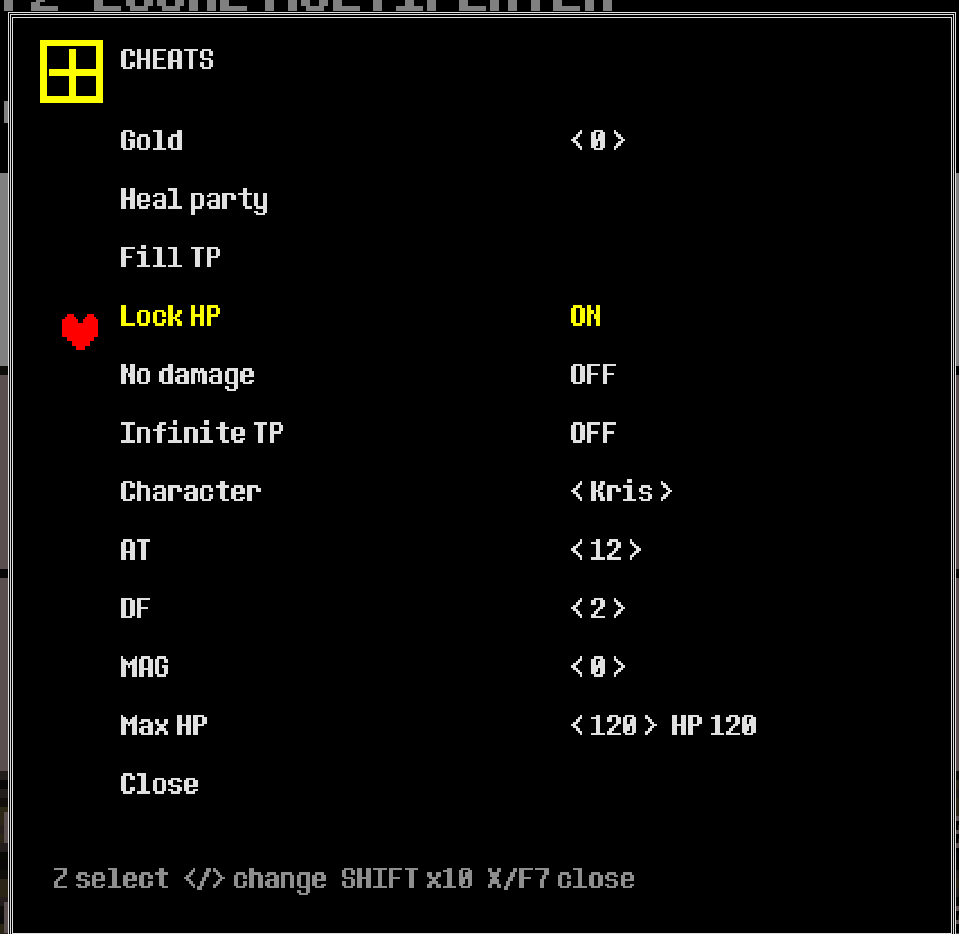
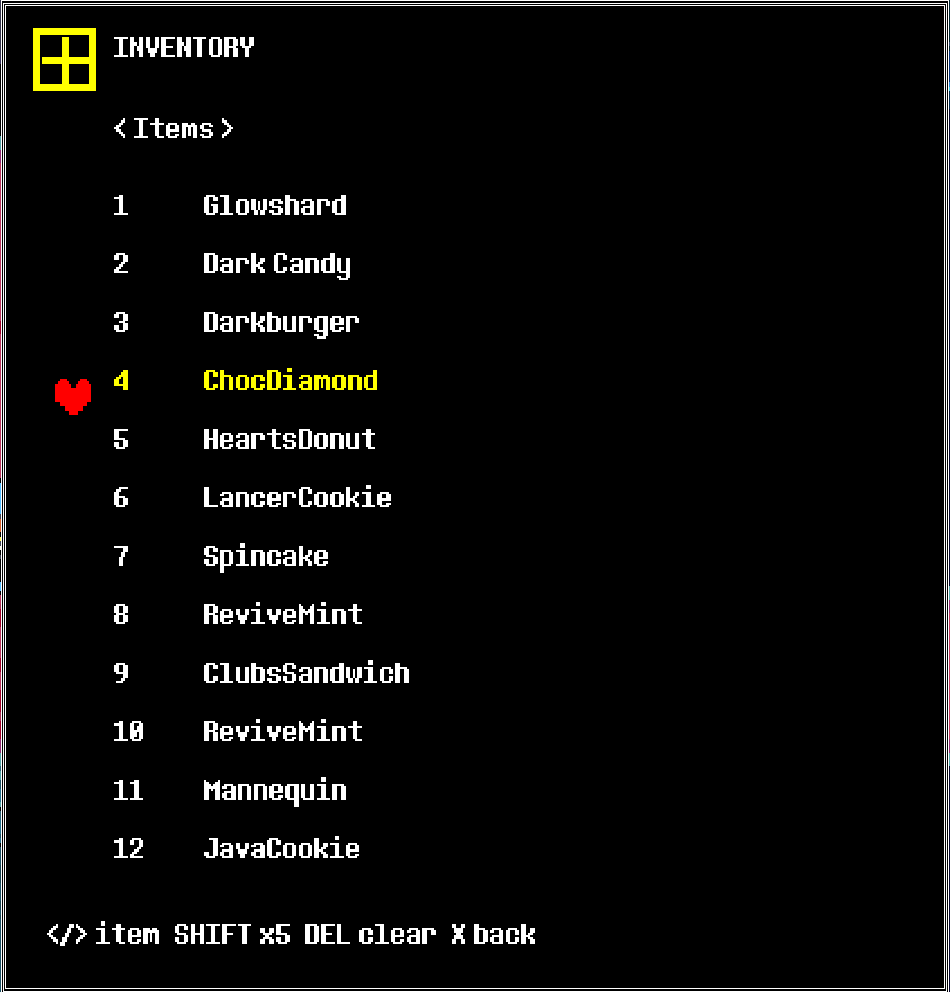

# CheatMenu (example mod)

An in-game version of the Cheat Engine table. Press **F7** anywhere, in the overworld or in battle. The game
freezes and a cheat overlay opens.



| Row | Keys |
|---|---|
| Money... | Z opens the money page (below) |
| Heal party / Fill TP | Z |
| Lock HP / No damage / Infinite TP | Z or ←/→ toggles; stays active after closing. Also covers Chapter 3's game-show board hearts |
| Puzzle timer | Z or ←/→ cycles OFF / SLOW x3 / FROZEN for the glow-tile puzzle timers (Chapters 1, 3 and 5, e.g. Chapter 5's `room_dw_garden_hardpressureplates`); stays active after closing. Pauses itself for Chapter 5's scripted four-switch puzzle, which the story needs you to fail |
| Walk speed | Z or ←/→ cycles OFF / x1.5 / x2 / x3; stays active after closing and across rooms. Scales the overworld walk and run speed (`obj_mainchara.bwspeed`); OFF puts back the game's exact value. Platformer, wall climbing, dash mode, the Chapter 3 board and scripted slow-walk scenes keep their own speed |
| Character | ←/→ picks the party member for the stat rows |
| AT / DF / MAG / Max HP | ←/→ ±1 (Max HP ±10; Shift ×10) |
| Inventory... | Z opens the inventory editor (below) |
| Enemies... | Z opens the enemy editor (below) |
| Recruits... | Z opens per-enemy recruit counts (Chapters 2–5; below) |
| TV Show... | Chapter 3 only: Z opens the TV show page (below) |
| Close | Z, X or F7 |

The box never grows past the screen: when the rows don't fit (the main page in every chapter, the
recruit list, a three-enemy battle) the list scrolls with the cursor and ▲/▼ marks the hidden rows.

### Enemy editor (battles)

Open F7 during a battle, then **Enemies...**:

| Row | Effect |
|---|---|
| Auto mercy | keeps every enemy at full mercy and Tired, so SPARE / Pacify always work (stays on after closing) |
| All: can spare | full mercy + Tired for every enemy, once |
| All: HP 1 | every enemy to 1 HP |
| per enemy: HP / Mercy / Tired | ←/→ ±10 (Shift ±100); Z toggles Tired |

Some enemies can't be spared in the real game, and forcing their spare state crashes or breaks
the scripted fight (seen sparing Chapter 2's Queen). For those, the editor hides Mercy/Tired,
auto mercy skips them, "All: can spare" leaves them alone, and the enemy is labelled
*(can't be spared)*. HP editing still works.

The list is generated per chapter from the game's own code by `tools/gen_nospare.csx`
(`chapterN_windows/code/gml_GlobalScript_scr_drcheat_nospare.gml`). An enemy is listed when:

- its SPARE event is a no-op (unless a battle-controller mercy ending replaces it, as for Spamton NEO),
- its step event forces its mercy back to 0 outside any ACT, or
- it has no spare points and none of its code ever raises its mercy.

| Chapter | Can't be spared |
|---|---|
| 1 | Lancer (2nd and 3rd fights), Dummy |
| 2 | Queen, GIGA Queen, Sweet / Cap'n / K_K, Berdly (1st fight), Pipis, Jigsaw Joe, Dummy |
| 3 | Tenna (both), Elnina, Lanino (1st fights), Knight, Jigsaw Joe, Dummy |
| 4 | Hammer of Justice, the ??? fight, Titan, Titan Spawn, Jackenstein, Swatchling, Jigsaw Joe, Dummy |
| 5 | Blue, Yellow, Jigsaw Joe |

Re-run it after a game update:
`DR_OUT_DIR=mods\CheatMenu\chapterN_windows\code UndertaleModCli load chapterN_windows\data.win -s tools\gen_nospare.csx`

### Money page

Open **F7 → Money...**. Each row is one currency of the current chapter: ↑/↓ picks a row, ←/→
changes it by the row's step (Shift: the big step; the footer shows both), X goes back. Each row
clamps to its own range (PT 0..9999, like the TV Show page; the rest 0..99999), but → never
lowers a value the game already put above the cap. Currencies of other chapters are hidden.

| Row | Storage | Chapters | Step / Shift |
|---|---|---|---|
| D$ | `global.gold` | 1–5 | 10 / 1000 |
| Light World $ | `global.lgold` | 1–5 | 10 / 1000 |
| PT | `flag[1044]` | 3–4 (Chapter 4 spends PT at Gerson's table) | 10 / 100 |
| Board points | `flag[1117]` | 3 (score of the current board) | 10 / 100 |
| F$ | `flag[1411]` | 5 | 10 / 1000 |
| P$ | `flag[1312]` | 5 | 10 / 1000 |

The rows come from the `drc_money` table in `scr_drcheat_page_money` (name, chapters,
storage, min/max, steps, help line), so a new currency is one more entry. Chapter 5's
`flag[1412]` records whether the Flowery Dollars are shown as part of
D$ or on their own line. It is story state, and the page never writes it. While it is 1, the money
box shows D$ + F$ but D$ shops only take `global.gold`; the page says so.

### Recruit editor (Chapters 2–5)

Open **F7 → Recruits...**. Each row shows an enemy type's recruited count and the count
required to finish recruitment. Use ↑/↓ to choose a type, ←/→ to adjust by one (hold Shift
for five), and C/Delete to reset a defeated (“LOST”) type to zero. X returns to the main page.
The editor lists recruitable enemy types from the current and preceding chapters, not bosses.
Chapter 1 has no recruitment system, so the row is unavailable there.

The game stores each type as `global.flag[600 + enemy ID] = count / required`, with `-1`
marking a lost recruit. The editor writes the proper fraction using the required count from
the game's `scr_recruit_info`, rather than changing a cosmetic total. Changes affect the
current save when the game saves; make a backup before editing story progress. Entering a
positive count for a LOST type deliberately clears its lost state.

### TV show page (Chapter 3)

| Row | Effect |
|---|---|
| Points | the PTs counter (`global.flag[1044]`), ←/→ ±100 (Shift ±1000), max 9999 |
| Board 1 rank / Board 2 rank | saved board result (`flag[1173]`/`[1174]`): Z C B A S T |
| Minigame assist | cooking show: popularity never drains to a loss; rhythm game: fame stays full (no fail); Susiezilla: the statue doesn't break |
| Minigame: top score | open F7 *during* a minigame, press Z, close: cooking show score → 640 (T), rhythm game points → 28000, Susiezilla score → 999 (ultimate victory) |

The saved rank opens the ranking-room doors (C ≥ C, B ≥ B, A ≥ A) and T opens the T-Rank room.
Finishing a board again overwrites it with the real result. The secret boss route isn't gated by
score: it needs the hidden keys found on each board.

### Chapter 4–5 notes

- Lock HP revives a party member knocked out by a one-hit attack (via the game's `scr_heal`), instead of leaving them down at full HP.
- Lock HP / No damage also cover Chapter 5's platformer Kris (own 30 HP + invincibility flag) and Chapter 4's Mike minigame (3 lives).
- Some boss fights script a party member going down (Sound of Justice, Flowery, Pink, Orange/Green). Those scenes force HP themselves and still play; Sound of Justice also has a 4-turn fallback.

### Inventory editor



Edits the Dark World inventory: **Items** (12 slots), **Weapons** and **Armor** (48 slots; 12 in
Chapter 1), and **Key Items** (12).

| Keys | Effect |
|---|---|
| ←/→ on the top row | switch category |
| ↑/↓ | pick a slot (the list scrolls) |
| ←/→ on a slot | cycle through every item the chapter has (Shift ×5) |
| Del / Backspace / C | empty the slot |
| X | back to the cheat page |

Item names come from the game's own `scr_iteminfo` / `scr_weaponinfo` / `scr_armorinfo` /
`scr_keyiteminfo`, so the list matches each chapter (and other mods' added items) automatically.
The game's menus stop at the first empty slot, so gaps are closed when you leave the page.
Equipped gear (`global.charweapon` / `chararmor`) and the Light World inventory aren't edited.

Install: copy `CheatMenu\` into `DELTARUNE\mods\`. It needs the loader plus `mods\tools\` (the UTMT CLI and
`ImportLooseMod.csx`).

## What it shows off

Everything is in `all_chapters\`, which is applied to every `chapterN_windows\data.win`:

- `code\gml_Object_obj_drcheat_*.gml`: a **new object**, created from nothing by naming its event code.
- `code\gml_GlobalScript_scr_drcheat_page_*.gml`: **new global scripts**, one per menu page (see below).
- `code\gml_Object_obj_time_Step_1.append.gml`: an **append patch**. It adds code to the end of the
  persistent `obj_time` step event without replacing it, so it stacks with other mods (tested
  together with LocalMultiplayer, which replaces that same script).
- `code\gml_Object_obj_time_Draw_64.patch`: a **find/replace patch** that shows "press F7" for about 5 s.
- `sprites\spr_drcheat_icon_0.png` + `.origin.txt`: a **new sprite**.
- `sounds\snd_drcheat_open.ogg`: a **new sound**, played through `snd_play(snd_drcheat_open)`.

"No damage" holds `global.inv` (the invulnerability timer), the same trick as the CE table, so
scripted hazards that bypass it still hit.

## Adding a page

`obj_drcheat` (Create / Step / Draw GUI) only holds the page registry, page switching, shared
helpers, the always-on main-page cheats and the main page itself. Every other page is one global
script, `all_chapters/code/gml_GlobalScript_scr_drcheat_page_<name>.gml`, defining
`scr_drcheat_page_<name>(_mode)`. It runs with `self` = the `obj_drcheat` instance, so its
`drc_*` variables and methods live there. Modes (the full contract is at the top of the Create event):

| Mode | When | Does |
|---|---|---|
| `"init"` | Create | set up state; return `{ label, why }` for the page's main-page row (`why != ""` shows the row as `-` and Z prints `why`), or `undefined` to leave the page out of this chapter |
| `"tick"` | every step while the menu is closed | always-on cheats (auto mercy, minigame assist) |
| `"opened"` | the step F7 opens the menu, before the game's instances are deactivated | look at live instances |
| `"step"` | every step while the page is shown | input: `drc_step` (-1/0/1 from ←/→ with key repeat), `drc_big` (Shift), `drc_ok` (Z/Enter) |
| `"draw"` | Draw GUI while the page is shown | box is `drc_bx/drc_by/drc_bw/drc_bh`; title at `(drc_bx + 50, drc_by + 12)`, rows from `drc_by + 48`, footer at `drc_by + drc_bh - 34`. `drc_list_top(sel, n, visible)` and `drc_draw_more(y_first, y_last, up, down)` scroll long lists |
| `"leave"` | X back to the main page, or closing the menu | clean up (the inventory page closes slot gaps here) |

Modes a page doesn't need just fall through and return `undefined`. Then add one line to the
registry in the Create event:

```gml
drc_page_add(scr_drcheat_page_<name>, 0);   // 1 = row at the top of the main page, 0 = at the bottom (above Close)
```

Keep a page's state in its own `drc_<prefix>_*` variables and `global.drcheat_<prefix>*` globals,
so two pages never touch the same lines.
